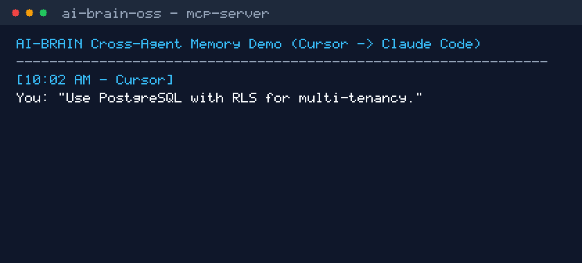
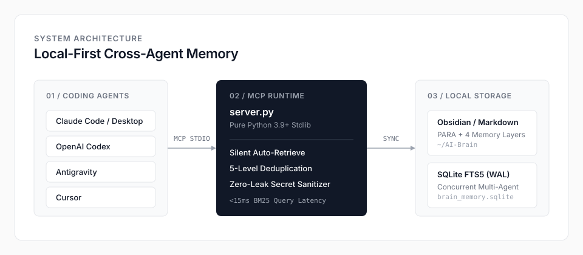

# AI-BRAIN

Your AI coding tools forget everything when you close a session. AI-BRAIN gives Claude Code, OpenAI Codex, Cursor, and Antigravity a shared memory on your computer using a local folder of plain Markdown files.

When you make a decision in Cursor, it is saved locally and available the next time you open Claude Code or Codex, without copying and pasting context.

- Switch between Cursor, Claude Code, Codex, and Antigravity without re-explaining your project.
- Keep everything in plain Markdown files (compatible with Obsidian) indexed by local SQLite FTS5.
- Run it with Python 3.9+ standard library only. No `pip install`, no Docker, and no external API keys.

## Start in Cursor, Continue in Claude Code (15-Second Demo)



```text
[10:02 AM — Cursor]
You: "Let's use PostgreSQL with row-level security for multi-tenancy."
Cursor (via brain-memory): Captures decision -> ~/AI-Brain/50_Memory/Semantic/Multi-Tenancy Auth.md
                           (Secrets auto-redacted, deduplicated, indexed in <5ms)

[10:15 AM — Claude Code / Antigravity / Gemini CLI]
You: "Implement the billing endpoint."
Claude (via brain-memory): Silently retrieves "Multi-Tenancy Auth.md" before answering
Claude: "I'll add the billing endpoint using PostgreSQL RLS tenant isolation as decided..."
```

## Try it in 1 Command

Paste one command in your terminal. It creates your local vault, initializes SQLite FTS5, and configures your installed MCP clients (Claude Code/Desktop, Cursor, Antigravity) without manual JSON editing.

**Option A: Zero-clone with `uvx` (60 seconds)**
```bash
uvx --from git+https://github.com/ai-brain-oss/obsidian-ai-brain ai-brain-setup --mode fresh --dest ~/AI-Brain --agents all --non-interactive
```

**Option B: Interactive wizard after cloning**
```bash
git clone https://github.com/ai-brain-oss/obsidian-ai-brain.git && cd obsidian-ai-brain && python3 setup.py
```

> Already have an Obsidian vault? Run with `--mode index --vault /path/to/your-vault --writable-inbox AI-Memory` to index your existing notes in read-only mode while keeping new AI memories isolated in `AI-Memory/`.

## What Problem It Solves

| Without AI-BRAIN | With AI-BRAIN |
| :--- | :--- |
| Session amnesia forces you to re-explain your stack, rules, and past decisions. | Decisions and conventions are captured automatically and recalled before you ask. |
| Cursor, Claude Code, Codex, and Antigravity each keep separate context. | Every MCP agent reads and writes to the same local Markdown vault. |
| Cloud memory services store your code and notes on external servers. | Everything runs offline on SQLite FTS5 and Markdown with automatic secret redaction. |
| Heavy setups require Docker, vector databases, or extra Python packages. | Pure Python 3.9+ stdlib delivers sub-15ms BM25 search and 5-level deduplication. |

## How AI-BRAIN is Structured



## Privacy & Security

- All indexing, retrieval, and storage happen on your machine. Nothing is sent to external clouds, third-party vector databases, or telemetry endpoints.
- Runs offline using Python's standard library, with no accounts, API keys, or subscriptions.
- A multi-pass regex sanitizer scrubs private keys, JWTs, OpenAI/Anthropic/Google API keys, GitHub tokens, Slack tokens, Bearer headers, and passwords before writing to disk.
- The vault lives outside your git repositories (by default at `~/AI-Brain`) so personal notes and database files are not committed by mistake.
- Licensed under the MIT License.
